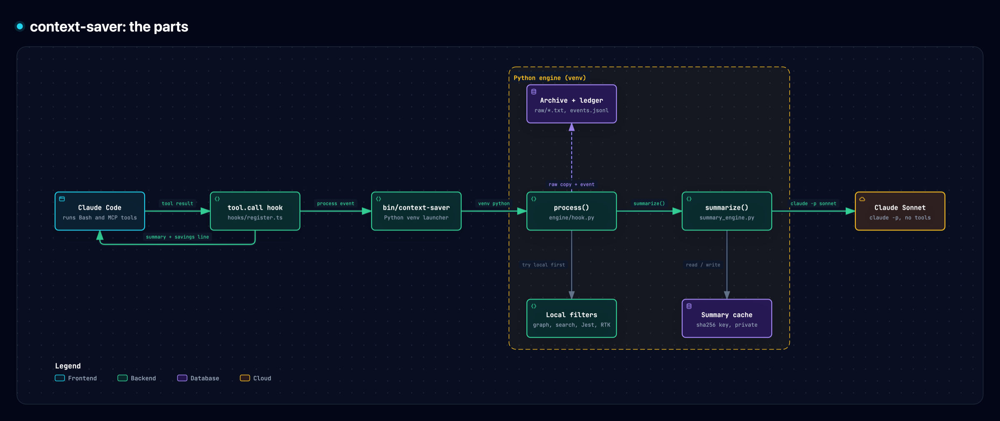
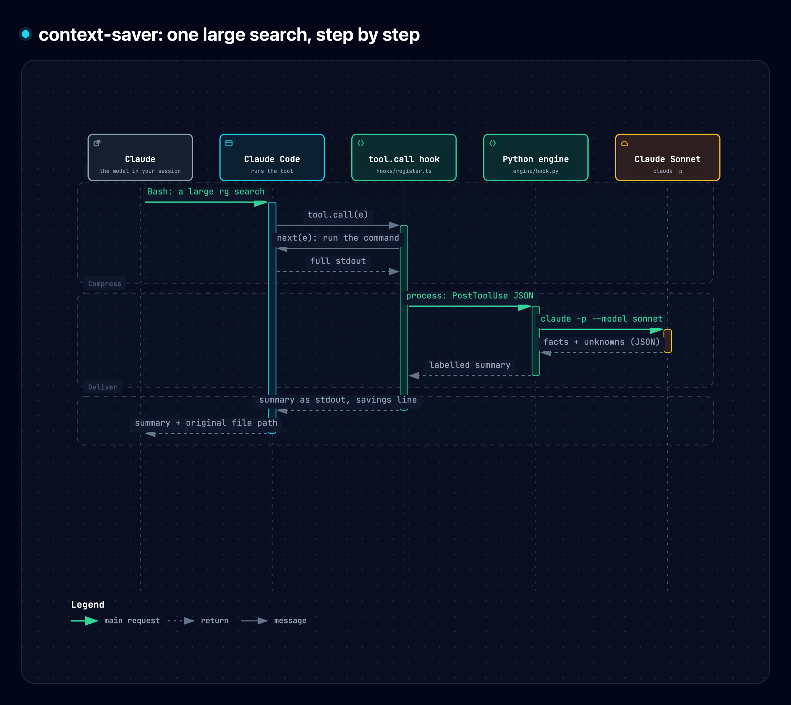
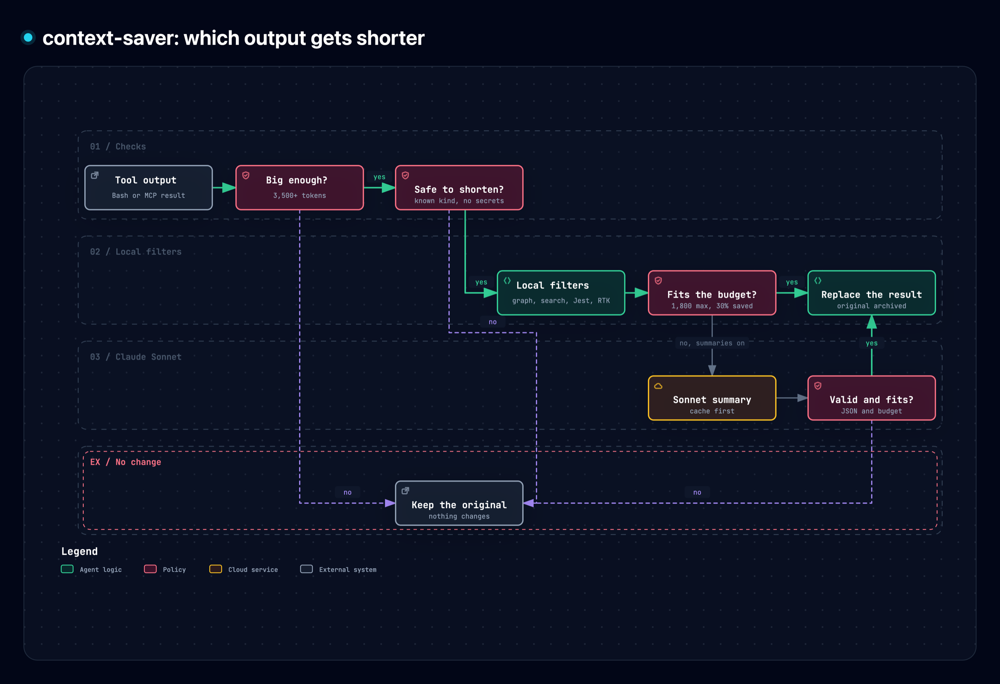

# context-saver for Claude Code

context-saver makes large tool output smaller before Claude reads it. It saves context tokens on long searches, git logs, test and build logs, and large MCP results. Each time it compresses a result, it shows the tokens saved:

```
⛁ context-saver: 7,066 tokens saved (7,627 → 561) by Claude (sonnet) · session 27,451
```

The status line under the prompt keeps the session total.

## Install

At the prompt of a Claude Code terminal session:

```
/plugin install context-saver --marketplace bargom/claude-context-saver
```

Answer `y` to add the marketplace, then pick a scope (user scope is first).

From a shell:

```sh
claude plugin install context-saver --marketplace bargom/claude-context-saver
```

In the desktop app: click **+** next to the prompt box, then **Plugins**, **Add marketplace** with `bargom/claude-context-saver`, then **Add plugin**.

The first session after install builds a private Python environment in the background (about 10 seconds, one time). Until it is ready, tool output stays unchanged. You do not need to do anything else.

### Requirements

- Claude Code with plugin mods (function hooks), 2.1.300 or newer.
- Python 3.10 or newer as `python3` (macOS or Linux).
- Optional: [RTK](https://www.rtk-ai.app/) on `PATH` for the local filters of Vitest, pytest, Cargo test and git output.

## Settings

Open `/config` and find the **context-saver** rows, or set them at install time.

| Setting | Default | What it does |
| --- | --- | --- |
| Summary effort | `medium` | Reasoning effort of Claude Sonnet, the summary model: `none`, `low`, `medium`, `high`, `xhigh` or `max`. |
| Summarize shell output | on | Send large shell output to the summary model when the local filters cannot make it smaller. Off: shell output gets local filters only. |
| Toast on each save | off | Also show a toast for each compressed result. The transcript line always shows. |

A change in `/config` applies at once.

## Commands

```
/context-saver                 savings of the last 7 days
/context-saver stats 30        savings of the last 30 days
/context-saver status          active settings, summary model and file locations
/context-saver disable         stop compressing (enable turns it on again)
/context-saver setup           rebuild the Python environment
/context-saver review <note>   record that you checked summary quality
```

To get the exact output of one shell command, put `CONTEXT_SAVER_RAW=1` in front of it:

```sh
CONTEXT_SAVER_RAW=1 rg -n handler src
```

## How it works



1. The plugin's mod watches every Bash and MCP tool call. The tool runs as usual, with your permission rules, sandbox, timeouts and streaming.
2. When the output is large (3,500 tokens by default), the mod gives the complete output to the engine (`engine/hook.py`).
3. The engine tries local filters first. These keep every identity and line number of known search results and drop passing tests from Jest reports. With RTK installed, they also drop passing tests from Vitest, pytest and Cargo reports and shorten git output.
4. When the local filters are not enough, Claude Sonnet writes a short, factual summary. It runs as `claude -p` with your normal Claude login, with no tools, no hooks, no MCP servers and no session files.
5. The mod replaces the output with the result, writes the savings line, and updates the session total. The ledger counts a saving only after Claude Code confirms that it used the result.



Claude Code saves Bash output over 30,000 characters to a file and shows Claude only a short preview. For such output Claude gets the summary in place of that preview, and the savings line says `vs full output`: the count is against the complete output, not against the preview.

The same applies to an MCP result over the Claude Code token limit: Claude Code saves it to a file, and Claude gets the summary in place of the error notice.

The model always sees where the original is. The engine keeps the complete original in a private archive and names the file on the third line of the result (`Original output: <path>`), so Claude can read the exact text when it needs details.



The engine leaves the output unchanged when:

- the command was interrupted, runs in the background, or returned an image;
- the output is small, or compression would save less than 30%;
- the output contains something that looks like a secret or a credential file path;
- the tool call reads source exactly (Read, file views, `get_code_snippet`);
- a shell command runs anything other than known search, git, test, build and log commands, `cd`, and plain filters of their piped output (`head`, `tail`, `sort`, `uniq`, `wc`, `cut`, `tr`, `cat` with no file);
- the summary model fails or times out (when the `claude` CLI is missing, not logged in, or out of credit, the engine waits 15 minutes before it starts the summary model again).

Output of a failed command can still get shorter, but the result keeps the original error lines and the end of the output (and of stderr) exactly. With **Summarize shell output** off, the output of a failed Codex command (non-zero exit code) stays unchanged. Claude Code gives no exit code for Bash.

### Cost

Summaries use the Claude login of your `claude` CLI (your Claude subscription), like any other `claude -p` call. API keys, endpoint overrides and cloud credentials in your environment are not passed to the summary process; proxy and CA certificate variables and `CLAUDE_CONFIG_DIR` are. The summary process turns off prompt caching, because each summary is a one-time prompt. In a benchmark of 16 real outputs, Sonnet at medium effort cost about $0.04 list price per summary and took about 7 seconds. Local filters and RTK cost nothing. `/context-saver stats` shows the helper tokens next to the context tokens saved, and counts the outputs that Claude Code saved to a file separately (`persisted_outputs`).

## Files

| Path | Contents |
| --- | --- |
| `~/.config/context-saver/config.json` | Optional advanced settings (see `config.example.json`). |
| `~/.local/share/context-saver/venv-<hash>` | The plugin's Python environment, one per version of its requirements; old ones are removed after a new one is ready. |
| `~/.cache/context-saver/raw/` | Originals of compressed outputs, owner-only, removed after `retention_days`. |
| `~/.cache/context-saver/events.jsonl` | The savings ledger that `/context-saver stats` reads. |

`CONTEXT_SAVER_CONFIG`, `CONTEXT_SAVER_STATE`, `CONTEXT_SAVER_DATA` and `XDG_CONFIG_HOME` / `XDG_DATA_HOME` move these locations.

### Advanced settings

Copy `config.example.json` to `~/.config/context-saver/config.json` and change what you need. The `/config` settings above always win over this file.

- `effort`: the Sonnet effort when no `/config` value is set, for example under Codex.
- `minimum_tokens`, `maximum_replacement_tokens`, `minimum_saving_fraction`: when a result is worth compressing.
- `categories`: which kinds of output to compress (`search`, `logs`, `git`, `documentation`).
- `rtk_enabled`, `rtk_binary`: the RTK stage (an empty `rtk_binary` means `rtk` on `PATH`).
- `retention_days`, `review_every_days`: archive cleanup and the weekly savings reminder.

## Use with Codex

The same engine works as a Codex hook. Clone this repository, run `bin/context-saver setup` once (the Codex sandbox cannot build the Python environment; use `setup --mcp` if you will wrap MCP servers), and add this to `~/.codex/config.toml` with the absolute path of your copy:

```toml
[[hooks.PreToolUse]]
matcher = "^Bash$"
[[hooks.PreToolUse.hooks]]
type = "command"
command = "/path/to/claude-context-saver/bin/context-saver pre-tool"
timeout = 5

[[hooks.SessionStart]]
matcher = "startup|resume|clear|compact"
[[hooks.SessionStart.hooks]]
type = "command"
command = "/path/to/claude-context-saver/bin/context-saver session-start"
timeout = 5

# The hook writes its archive and ledger here in workspace-write sessions.
[sandbox_workspace_write]
writable_roots = ["/Users/you/.cache/context-saver"]
```

Review the new hooks with `/hooks` in Codex to trust them.

In Codex the hook rewrites eligible shell commands to run through `context-saver run`, which keeps the exit code and compresses the output.

- **MCP results:** wrap a server with the proxy, for example `context-saver mcp-proxy --server codebase-memory-mcp --stdio /path/to/codebase-memory-mcp`, or `--http <url>` for a remote server. The proxy needs the MCP SDK (`setup --mcp`). Until the environment is ready, a `--stdio` server runs unwrapped; an `--http` server starts the SDK setup in the background and fails until it is done. Give the wrapped server time for the summary:

  ```toml
  [mcp_servers.codebase-memory-mcp]
  command = "/path/to/claude-context-saver/bin/context-saver"
  args = ["mcp-proxy", "--server", "codebase-memory-mcp", "--stdio", "/path/to/codebase-memory-mcp"]
  tool_timeout_sec = 360
  ```

  The proxy adds `limit: 20` to a `search_graph` call of codebase-memory-mcp and `limit: 3` to a `search_openai_docs` call of openaiDeveloperDocs when the call gives no limit.
- **Native web results:** run `context-saver web-bridge` and load its output in `functions.exec` with `new Function('tools', source)(tools)`; call the returned function in place of `tools.web__run`, with `{raw: true}` for exact quotes. Codex needs `features.code_mode = true` for this path.
- **Claude login in the Codex sandbox:** the sandbox blocks the macOS Keychain. Put the output of `claude setup-token` in `~/.config/context-saver/claude-token.txt` (mode 0600). Only the `claude` helper process receives it.

## Development

```sh
bin/context-saver setup                                     # Python environment
venv=~/.local/share/context-saver/venv-$(shasum -a 256 < engine/requirements.txt | cut -c1-12)
"$venv/bin/python" -m unittest discover -s engine -p 'test_*.py'
node --test engine/test_web_bridge.cjs
claude plugin validate .                                    # manifest, marketplace and mod
claude plugin test .                                        # mod tests (hooks/*.test.ts)
claude --plugin-dir .                                       # a session with this copy loaded
```

## License

MIT. See [LICENSE](LICENSE).
